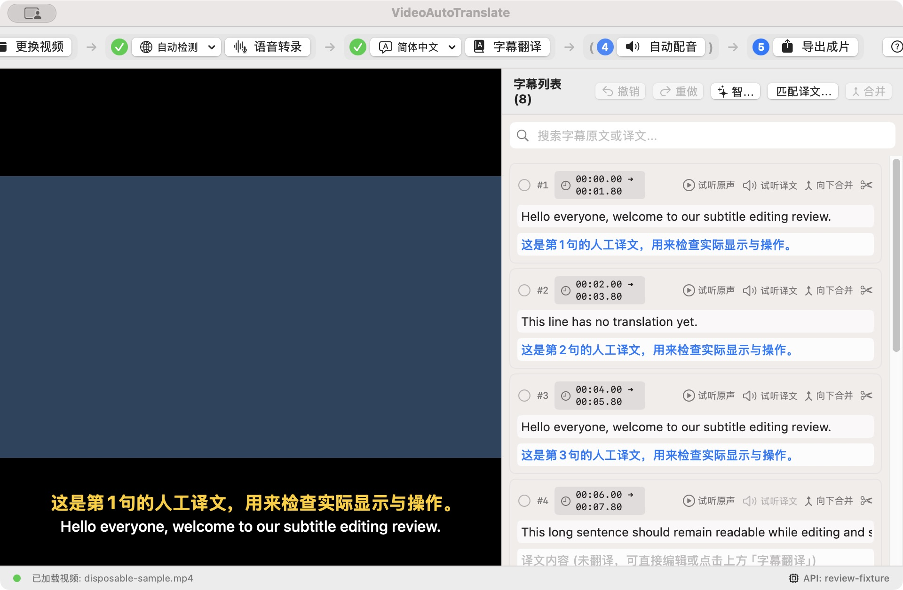
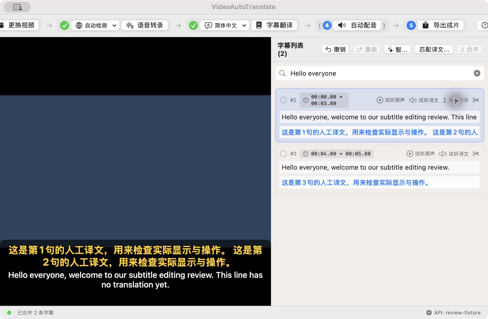
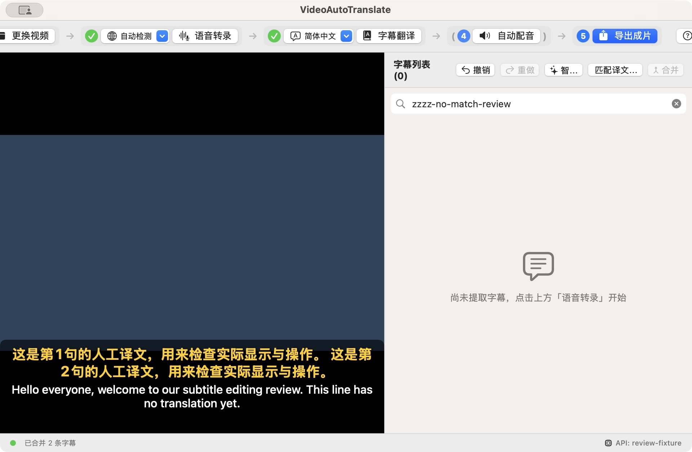
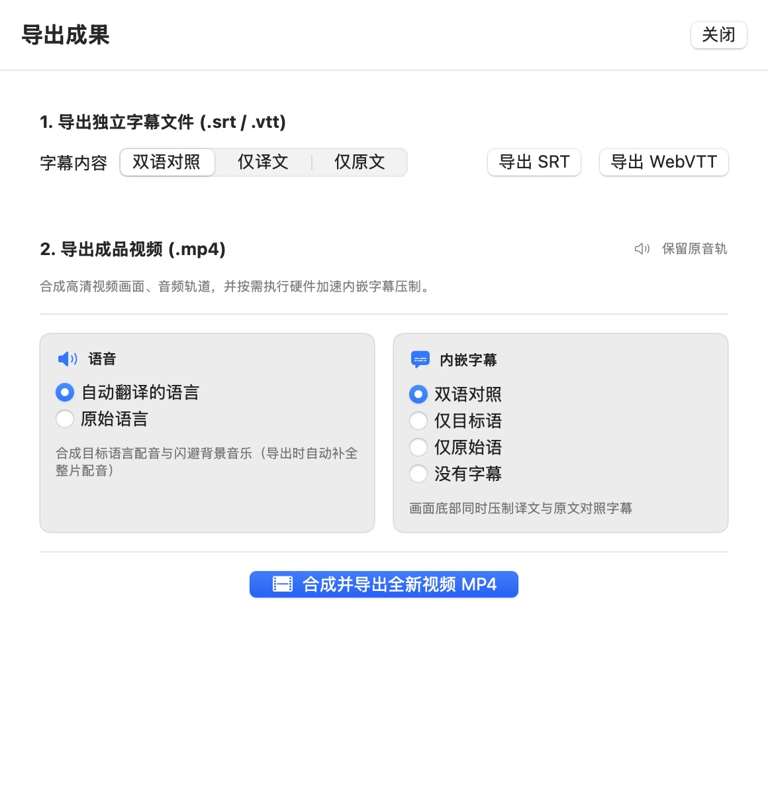

# 全仓评审：用户体验、功能与 UI

- 评审日期：2026-10-21（Asia/Singapore）。
- 基线：`b33597ce9127683882c345d5f07a19e83fbebdc7`，本轮开始时已更新的 main；本文源码行号均指此提交。
- 重点：按用户从导入到导出的任务流程审阅，结合底层实现确认行为。不是只检查上一轮修复，也不是视觉风格偏好清单。
- 范围：9 个 App Swift 文件、27 个 Core Swift 文件；两份 Swift 测试、ASR 与 E2E 脚本、构建/发布流程、README 和三份设计文档。逐项范围见验证记录。
- 交付：只写评审文档、隔离验证程序及证据；不修改生产功能，不替换 dist 中应用。

## 1. 结论

项目的正常路径已有明显进展：能识别、翻译、编辑、试听和导出；新增了撤销、语义分句、译文时间轴匹配、双试听按钮和两列导出选项。本次 **25 个 XCTest 全部通过**，Release 构建成功，发布脚本测试通过。

当前最需要改善的是**操作结果的可预测性和编辑成果的安全性**。有些界面会展示“完成”，但用户得到的可能是另一工程的字幕、丢失译文的重新分句、不完整配音，或越过视频结尾的时间轴。即使不讨论算法质量，这些行为也会让用户不敢继续编辑或交付成片。

本轮整理 **24 项可行动发现：11 项 P1、13 项 P2，无 P0**。它们包含已知能力缺口、旧问题残留和新功能回归，不代表 24 个全新漏洞。P1 优先处理编辑丢失、崩溃、错误内容及主要交付阻断；P2 是特定操作错误、反馈误导和核心交互能力缺口。

建议先稳定“保存—编辑—撤销—异步写回—完整导出”，再继续增加自动化按钮。尤其字幕拆分和调时，应从直接改数组升级为可预览、可验证、可撤销的编辑操作。

## 2. 证据与界面样本

- **动态**：调用当前基线代码，用临时工程及确定性输入复现。
- **注入**：只替换外部模型响应或初始化数据，保留业务控制流；没有把注入结果当成真实识别质量测试。
- **GUI 样例**：从基线编译实际 SwiftUI 界面，注入 20 秒合成媒体和 8 行字幕，移除初始化服务探测，不改布局、按钮闭包或状态逻辑。以下图片不是设计稿。
- **静态**：源码路径明确，但未执行真实故障/交错场景。每项注明，避免把代码推断称为已观测事实。

详细执行、复现入口和边界见[验证记录](2026-10-21-ux-functional-evidence.md)；[结构化结果](evidence/ux-2026-10-21/probes.jsonl)保留预期崩溃子进程的退出状态。

## 3. 发现索引

| ID | 优先级 | 用户可见的问题 | 主要证据 |
| --- | --- | --- | --- |
| U01 | P1 | 没有可用的保存/恢复入口，更换媒体或退出会丢编辑 | 静态＋GUI 菜单结构 |
| U02 | P1 | 文字撤销保存了修改后的状态，加载工程还保留旧历史 | 动态 |
| U03 | P1 | 智能分句/时间轴任务能在更换视频后写回旧字幕 | 注入 |
| U04 | P1 | 时间轴模型返回重复 ID 会令应用直接崩溃 | 注入，子进程 |
| U05 | P1 | 智能分句可改写原文，且清空已有人工译文 | 注入＋静态 |
| U06 | P1 | 时间轴匹配可超出视频；边界修正还会重新造成重叠 | 动态＋静态 |
| U07 | P1 | 首词内光标会拆到句尾；Unicode 光标单位也不一致 | 动态＋静态 |
| U08 | P1 | 搜索后“向下合并”会修改用户看不见的行 | GUI 动态 |
| U09 | P1 | 缺少对齐结果时仍把整段识别文本放到固定 0–5 秒 | 注入 |
| U10 | P1 | 补配音失败被吞掉，仍可能导出缺句或混合语言的成片 | 静态 |
| U11 | P2 | 用户没有人工调起止时间、查看波形及修正对齐的入口 | GUI＋静态，能力缺口 |
| U12 | P2 | 拆分译文全部留左句，右句空白且无“待分配”状态 | 动态 |
| U13 | P2 | 翻译序号容错会错配，部分返回也被当作整批完成 | 注入 |
| U14 | P2 | 改目标语言不会使旧译文/音频失效或提示重新生成 | 静态 |
| U15 | P2 | 导出未冻结字幕，也不能可靠取消和阻止重复导出 | 静态 |
| U16 | P2 | 导出校验未接界面，“待翻译”可直接进入成品 | 动态＋静态 |
| U17 | P2 | 默认窗口的关键按钮被裁切；长句不能完整校对 | GUI |
| U18 | P2 | 帮助中的快捷键与真正可执行命令不一致 | 静态＋GUI 结构 |
| U19 | P2 | 搜索无结果被误报为尚未识别，并引导重新转录 | GUI |
| U20 | P2 | 部分完成被画成完成；失败也用绿勾，音轨摘要矛盾 | GUI＋静态 |
| U21 | P1 | 新机器的引擎准备仍依赖外部 Python，缺少产品内恢复路径 | 静态，交付缺口 |
| U22 | P2 | 模型设置在最需要安装时隐藏安装入口，配置也易失效 | 静态＋GUI |
| U23 | P2 | 快速切换试听时，迟到结果可抢播；原声定位也受重排影响 | 静态 |
| U24 | P2 | “新语言配音与背景音乐”实际上仍叠加完整原人声 | 静态 |

## 4. P1：先保证用户不会丢成果或得到错误成品

### U01 保存函数没有成为用户可用的保存功能

位置：[AppState.swift:866](../Sources/VideoAutoTranslateApp/AppState.swift#L866)、[247](../Sources/VideoAutoTranslateApp/AppState.swift#L247)，[VideoAutoTranslateApp.swift:65](../Sources/VideoAutoTranslateApp/VideoAutoTranslateApp.swift#L65)。

工程编解码、saveProject/loadProject、isDirty 已存在，但全仓调用检索只有保存/加载函数定义，没有文件菜单、按钮、快捷键或工程文件打开路由。界面没有未保存标志；更换视频直接 reset 并清空撤销历史，退出没有保存确认或恢复机制。用户不能用导出 SRT 来恢复词映射、缓存和工程设置。

这是上一轮能力缺口的持续状态，而不是“已有保存按钮坏了”。建议先接通保存、另存为、打开工程和 Cmd+S；切换媒体、重新识别、关闭时提供保存/取消；再做原子自动保存和恢复。工程应管理派生音频而非只存临时 URL，目前文档也不恢复 audioURL。验收：编辑、拆分、调时、翻译后重开一致；写入失败可重试；旧素材移动能重新定位。

### U02 撤销记录时机错误，并存在跨工程历史污染

位置：[SubtitleItem.swift:12–23](../Sources/VideoAutoTranslateCore/Models/SubtitleItem.swift#L12-L23)，[AppState.swift:67–79](../Sources/VideoAutoTranslateApp/AppState.swift#L67-L79)、[573–595](../Sources/VideoAutoTranslateApp/AppState.swift#L573-L595)、[874](../Sources/VideoAutoTranslateApp/AppState.swift#L874)。

文字 didSet 才调用 onModified，回调再记录当前快照，所以记录的是修改后的文本。直接运行真实 AppState：`Before → After → undo` 得到的仍是 `After`。1.2 秒的全局节流也没有明确编辑事务边界，快速跨行编辑、程序翻译写回会混入同一历史。

loadProject 还没有清空 undo/redo。验证中加载 B 后执行 undo，字幕变成 `Project A`。这条加载路径暂未接 UI，但应在接入前修复；否则保存入口完善后会立即暴露。

建议在操作提交前保存旧值，区分文字编辑合并窗口和结构操作，后台结果不能伪装为人工输入；切换/加载工程统一重建历史。验收：首字输入、长输入、跨行、撤销后继续输入、加载后撤销，都有明确一致的结果。

### U03 新增自动操作绕过了任务取消与工程归属保护

位置：[AppState.swift:735–809](../Sources/VideoAutoTranslateApp/AppState.swift#L735-L809)。

runSmartSegmentation 和 matchTimelineToTranslation 不持有可取消任务，不捕获/核验 projectGeneration；await 后直接覆盖当前 project.subtitles。更换视频按钮与拖放仍然可用。延迟假模型验证两条路径：A 发起任务，切换 B，等待响应，B 均被写入 `Project A` 字幕并显示成功。点击底部取消也不能使这两条路径失效。

建议所有生成任务使用同一工程 ID、generation、输入 revision 与取消协议，结果作为建议或事务提交；每个 await 后检查，取消后不再改字幕、状态及进度。验收：分句/匹配中更换视频、打开工程、取消及人工编辑，迟到结果均不能直接覆盖。

### U04 重复的时间轴 ID 可使整个进程崩溃

位置：[TimelineAligner.swift:368](../Sources/VideoAutoTranslateCore/LLM/TimelineAligner.swift#L368)。

外部模型返回的 subtitles 数组直接传入 `Dictionary(uniqueKeysWithValues:)`。两项相同 id=0 即触发不可捕获的 fatalError；隔离子进程退出 -5，日志为 `Duplicate values for key: '0'`。这与上一轮翻译器已修好的重复 ID 崩溃属于相同错误模式，但出现在新路径。

建议先验证唯一性、完整 ID 集、有限数字及合法区间，非法响应整体回退或明确报错；绝不能在用户操作中崩溃。回归应通过真实客户端与解析路径注入重复、缺失、未知、倒序及巨值，而不是只测正常数组。

### U05 智能分句可偷偷改写原文，且会丢掉整批译文

位置：[LLMSegmenter.swift:122–159](../Sources/VideoAutoTranslateCore/LLM/LLMSegmenter.swift#L122-L159)，[AppState.swift:735–768](../Sources/VideoAutoTranslateApp/AppState.swift#L735-L768)。

对齐函数只按模型句子的空格词数消费原 token，不比对词内容。输入 `Hello world`，模型返回 `Goodbye moon`，实际结果是原文 `Goodbye moon` 搭配 `Hello|world` 的词时间。中文无空格的整句也不能用英文空格词数代表 ASR token 数。提示词要求“不改词”不是数据验证。

另外，每个新 SubtitleItem 没有 translatedText，AppState 将整个列表替换；用户已翻译或人工校对后点击仍可用的“智能分句”，译文全部消失，没有预览/确认。撤销结构快照有帮助，但不能替代正确的内容迁移和保护。

建议让模型只返回 token 边界/ID，原文由可信 token 重建；完整覆盖和顺序验证失败就拒绝。已有译文先显示影响及待分配方案，保留来源关系；不能把“重新分句”实现成“重新写全部原文并清空译文”。

### U06 时间轴匹配尚不能兑现“不越界、不重叠、自然语速”的承诺

位置：[AppState.swift:794–799](../Sources/VideoAutoTranslateApp/AppState.swift#L794-L799)，[TimelineAligner.swift:253–257](../Sources/VideoAutoTranslateCore/LLM/TimelineAligner.swift#L253-L257)、[368–384](../Sources/VideoAutoTranslateCore/LLM/TimelineAligner.swift#L368-L384)、[416–445](../Sources/VideoAutoTranslateCore/LLM/TimelineAligner.swift#L416-L445)。

界面调用未传 videoDuration。原 5 秒视频中最后一句 4–5 秒、较长译文，确定性算法会延长到 6.2 秒；最终视频合成按原视频长度截取音频，越界部分无法交付。LLM 解析只约束 start 的漂移，safeDur 却可按自然估计/模型请求扩大，不能保证 end 也局限在所在语音簇。

即使主动给 Core 传视频时长，末尾约束仍有错误：先保证不重叠，再把装不下的行都退到 `maxDur - 0.25`，没有再次检查前一行。5 行挤入 1 秒，实际得到 `0.04–0.39, 0.47–0.82, 0.75–1, 0.75–1, 0.75–1`，出现 3 次重叠。没有足够时间时，正确结果应是“需要用户处理”，而不是伪造一组满足全部条件的时长。

建议先建立不可违反的媒体边界和声学锚点约束，再输出分配提案；无法满足时保留原时轴并列出冲突。接入真实 TTS 时长校验，不能只根据字数宣称发音完全吻合。验收：短视频末尾、连续密集句、极长译文、模型异常时长和重复应用，检查所有不变量及音频尾部。

### U07 拆分仍会违背光标意图，Unicode 光标也会偏移

位置：[SubtitleManager.swift:55–85](../Sources/VideoAutoTranslateCore/Manager/SubtitleManager.swift#L55-L85)，[SubtitleRowView.swift:29–44](../Sources/VideoAutoTranslateApp/SubtitleRowView.swift#L29-L44)、[143–148](../Sources/VideoAutoTranslateApp/SubtitleRowView.swift#L143-L148)。

词边界搜索从第 2 个词开始；光标在首词内部时找不到边界，最终落到倒数第 2 个词后。动态 `Hello world third fourth`、index=2，得到 `Hello world third | fourth`。已有两词测试覆盖不到该情形。

界面取 NSTextView.selectedRange().location（UTF-16 单位），却按 Swift String.count/offsetBy 的 Character 单位传入和截断。`😀a bc` 在 b 前的光标 loc=4，最终切成 `😀a b | c`；更靠后还可能因范围判断失败只响一声。缓存光标也只按文字相同判定归属，重复文本行需要按编辑器身份区分。

建议以实际编辑器、行 ID 和原文 revision 保存选择范围，明确转换 UTF-16 索引；对全部词边界按距离选择候选，首词和末词单独覆盖。需要吸附时展示实际断点，映射失效时给出原因与人工修正入口。

### U08 搜索后的“向下合并”会改到隐藏行

位置：[SubtitleListView.swift:157–167](../Sources/VideoAutoTranslateApp/SubtitleListView.swift#L157-L167)、[190–192](../Sources/VideoAutoTranslateApp/SubtitleListView.swift#L190-L192)，[AppState.swift:657](../Sources/VideoAutoTranslateApp/AppState.swift#L657)。

界面用过滤结果的下一项决定是否显示按钮和显示行号，但处理函数查原始项目的下一项。GUI 样例搜索 `Hello everyone`，只显示原第 1、3 行；第一行“向下合并”后，合并的是被隐藏的原第 2 行，原第 3 行还在。显示 #2 让用户更难识别目标。

建议过滤时禁用隐含邻接操作，或明确列出将合并的真实工程行与预览；不能为迎合视觉邻接而跨过中间字幕。列表行号应稳定，过滤后显示“2/8 条”。验收必须覆盖隐藏中间行、最后可见行、过滤改变和残留多选。

### U09 对齐缺失时，固定五秒区间仍伪装成有效字幕时间

位置：[asr_server.py:666–692](../scripts/asr_server.py#L666-L692)，[LocalASRService.swift:183–200](../Sources/VideoAutoTranslateCore/ASR/LocalASRService.swift#L183-L200)。

未安装 aligner、对齐失败，且 ASR 只返回 text 而无 segments 时，服务把整段文本放在 0–5 秒返回成功。注入有正常识别文本、无时间信息的假模型确认了这一响应；Swift 又将 segment 当词 token。对于长视频，字幕和后续配音集中到开头，界面仍称逐词对齐完成。

本次没有声称真实已安装模型一定不返回 segments；缺陷是这个明确可达的兜底。建议返回“识别完成、待对齐”，保留文本但禁止伪造精确锚点；引导下载/修复 aligner 或人工调时。真实静音也应区别于服务故障，不统一报未解析出词条。

### U10 “导出时自动补全整片配音”并无完整性保证

位置：[AppState.swift:482–501](../Sources/VideoAutoTranslateApp/AppState.swift#L482-L501)，[ExportView.swift:279–325](../Sources/VideoAutoTranslateApp/ExportView.swift#L279-L325)，[AudioMixer.swift:82–117](../Sources/VideoAutoTranslateCore/Audio/AudioMixer.swift#L82-L117)。

ensureAllSubtitlesDubbed 返回 Void，逐句 TTS 失败只 print 后继续；混音对缺失文件、无音轨、插入失败也会跳过。只要还存在背景或其他片段，导出可以成功而不报告缺句。runFullDubbing 同样把逐句失败降为日志后显示完成。此项为静态确认，没有用真实系统 TTS 制造磁盘故障。

未翻译行还回填原文并用目标语言音色朗读。当只翻译一部分就选“自动翻译的语言”导出，可能得到混合语言；用旧缓存 URL 的存在性作为有效性，也无法证明文字、音色和时长正确。

建议补齐阶段返回逐行结果、失败数和原因，校验每段可读/有声/匹配输入指纹。完整配音导出默认阻止失败，允许明确接受的跳过/原声回退，但必须显示缺口。删除“杜绝失声”之类无数据支持的绝对保证。

### U21 新设备还不能靠界面完成引擎准备

位置：[ASRSidecarManager.swift:65–129](../Sources/VideoAutoTranslateCore/ASR/ASRSidecarManager.swift#L65-L129)，[build_app.sh:19–25](../build_app.sh#L19-L25)，[README.md:7](../README.md#L7)。

发布包只带 Swift 可执行文件和 Python 脚本；运行时仍从外部 venv、Conda、Homebrew、甚至另一项目 VideoLingo 中探测。依赖探测只 import fastapi/uvicorn，未证明 multipart、mlx_audio 和实际模型加载可用；错误输出被重定向，普通用户只有启动失败/超时。README 的轻量安装体积和“一键在新设备下载”没有解释额外运行时、模型体积及准备步骤。

这是静态交付缺口，未在干净 Mac 实测，也没有据此判断当前开发机不能运行。建议选定受管运行时或有校验与版本锁的安装流程，提供可读的准备清单、诊断日志、重试及离线条件说明。发布前单独验证没有任何开发目录的首次启动。

## 5. P2：让校对、状态和导出符合用户理解

### U11 核心调时能力仍不可用，自动结果没有人工兜底

位置：[SubtitleRowView.swift:68–82](../Sources/VideoAutoTranslateApp/SubtitleRowView.swift#L68-L82)，[SubtitleListView.swift](../Sources/VideoAutoTranslateApp/SubtitleListView.swift)，[VideoPlayerView.swift](../Sources/VideoAutoTranslateApp/VideoPlayerView.swift)；需求见 [PRD §4.5](../docs/PRD.md#L95)。

时间胶囊只能 seek，没有可输入的起止时间、波形、播放头拆分或拖动边界。用户发现一句提前、延后或重叠时，只能寄希望于再次自动匹配。单句循环、上下文试听、前后句导航也没有产品级入口。此项是设计中明确提出的核心能力缺口，不应冒充某个已实现控件的 bug。

建议先实现成本较低的起止时间检查器、±10/100ms 微调、前后句导航和循环试听，再补波形拖动。所有调整形成一次事务，显示邻句/媒体边界冲突，保留词锚点与人工时间保护状态。

### U12 拆分后的译文分配会误导校对和成品

位置：[SubtitleManager.swift:129–155](../Sources/VideoAutoTranslateCore/Manager/SubtitleManager.swift#L129-L155)，[AppState.swift:678](../Sources/VideoAutoTranslateApp/AppState.swift#L678)。

完整人工译文一律放左句，右句为空；动态结果仍如此。虽然字符没有全部丢失，语义归属已经不正确，后续配音会在左句窗口读整段，右句可能回填原文。界面没有“译文待分配”，也没有断点预览；拆分后选中左句而非需求中的右句。

建议展示原文/译文两套断点，允许暂缓但持久保存待分配记录；待分配应阻止自动当成已完成译文或要求用户确认。回归需覆盖中英倒装、人工译文、拆分撤销重做和导出。

### U13 翻译容错以静默错配替代了完整性检查

位置：[SubtitleTranslator.swift:190–200](../Sources/VideoAutoTranslateCore/LLM/SubtitleTranslator.swift#L190-L200)、[256–268](../Sources/VideoAutoTranslateCore/LLM/SubtitleTranslator.swift#L256-L268)，[AppState.swift:401](../Sources/VideoAutoTranslateApp/AppState.swift#L401)。

数字 ID 的 0 和 1 都映射到第一句。假响应两句分别返回 id=0、1，结果是 `First translation | 空`，调用仍成功。只返回第一句正确 UUID 时，第二句空白也不报部分失败。完全未知 ID 但条数相同，还会按返回顺序赋给字幕，模型重排序时可能把译文配错原文。

建议固定请求/响应 ID 协议，若兼容数字序号就先统一识别整批的基数，禁止逐项猜测；验证准确覆盖集合，按成功/失败/过期统计。界面提供“仅重试失败行”和“重译已校对行”的明确选项，完成文案用实际写入数。

### U14 切换目标语言后，旧内容仍被当作新语言结果

位置：[MainView.swift:196–199](../Sources/VideoAutoTranslateApp/MainView.swift#L196-L199)、[364–371](../Sources/VideoAutoTranslateApp/MainView.swift#L364-L371)，[AppState.swift:527–529](../Sources/VideoAutoTranslateApp/AppState.swift#L527-L529)。

语言菜单只修改 targetLanguage；字幕没有记录译文语言/输入版本，缓存也没有音色与文本指纹。中文译完并试听后切为日语，工具栏仍显示翻译已完成，试听若缓存存在就直接播放旧中文；导出同样可以复用旧音频。重新翻译又没有“保留人工校对”策略，用户难以判断该做什么。

建议译文记录目标语言及 source revision，音频记录译文/音色/时长指纹；切换设置显示影响范围，不删除人工成果，标记需要重译/重生成。回归：改语言、改音色、改时间、撤销后试听和导出。

### U15 导出没有稳定的快照与生命周期

位置：[ExportView.swift:30](../Sources/VideoAutoTranslateApp/ExportView.swift#L30)、[271–320](../Sources/VideoAutoTranslateApp/ExportView.swift#L271-L320)，[MainView.swift:313](../Sources/VideoAutoTranslateApp/MainView.swift#L313)。

之前冻结字幕副本的保护已在新自动补配音路径中退回：只冻结视频/背景音与模式，await 后混音、压字幕读取活跃 project.subtitles。导出不设置工程忙碌状态，没有 Task 句柄或取消接口；“关闭”始终可用。关闭面板后用户可换视频/编辑，再开面板发起第二次导出，前一任务仍可能继续；旧画面可能配上新字幕。

建议创建独立 ExportJob，冻结媒体、不可变字幕值、输入指纹及所需音频；作业进度持久可见，关闭面板不等于取消，取消则真实传递到底层。未测试真实长视频交错，以上为代码路径确认；回归应覆盖关闭、换媒体、并行导出及失败恢复。

### U16 校验报告没有进入导出决策，占位符可直接交付

位置：[SRTExporter.swift:59–84](../Sources/VideoAutoTranslateCore/Exporter/SRTExporter.swift#L59-L84)、[103–107](../Sources/VideoAutoTranslateCore/Exporter/SRTExporter.swift#L103-L107)，[ExportView.swift:237–251](../Sources/VideoAutoTranslateApp/ExportView.swift#L237-L251)。

validate 已实现，但没有界面调用。未翻译行在仅译文模式输出中文 `[待翻译]`，即使目标为其他语言也一样；无效时间仍被跳过。动态单行未翻译时 `valid=1, untranslated=1`，导出正常返回占位符。修复了旧版漏行，却没有让用户明确接受缺译成品。

建议导出面板显示可交付、缺译、待分配、无效时间和配音失败数量；点击定位并允许处理或明确接受的跳过。占位符只能作为预览选项，默认成品不能悄悄带出。SRT/VTT 与压制视频使用同一套校验语义。

### U17 工作台不能在自身允许的窗口尺寸中可靠呈现

位置：[MainView.swift:81–344](../Sources/VideoAutoTranslateApp/MainView.swift#L81-L344)，[SubtitleListView.swift:13–109](../Sources/VideoAutoTranslateApp/SubtitleListView.swift#L13-L109)，[SubtitleRowView.swift:51–174](../Sources/VideoAutoTranslateApp/SubtitleRowView.swift#L51-L174)，[VideoAutoTranslateApp.swift:78](../Sources/VideoAutoTranslateApp/VideoAutoTranslateApp.swift#L78)。

实际默认窗口截图中，顶部第一步骤/更换按钮左侧被裁切，右侧设置没有出现在可见区域；列表工具栏“智能分句”“匹配译文时间轴”变成缩略文字。大量 fixedSize 的单行流程条没有紧凑模式或溢出菜单。右侧最小宽度仅 320，而每行塞进勾选、行号、时间、两种试听、合并和剪刀。

编辑框使用单行 TextField。样例长句在右边被截断，用户不能一眼看完整句，也没有行长/阅读速度警告。建议顶部只保留主要下一步，配置和低频动作放菜单；右侧标题栏压缩为少量高频操作，行内显示更简洁的图标并有可读标签；原文/译文使用可增长的多行编辑器。验收覆盖最小窗口、常见笔记本尺寸、长语言标签、长句和放大字体，不能只在大窗口审美验收。

### U18 帮助列出的快捷键不等于可执行命令

位置：[HelpView.swift:83–105](../Sources/VideoAutoTranslateApp/HelpView.swift#L83-L105)、[267](../Sources/VideoAutoTranslateApp/HelpView.swift#L267)，[SubtitleRowView.swift:129](../Sources/VideoAutoTranslateApp/SubtitleRowView.swift#L129)，[VideoAutoTranslateApp.swift:74–83](../Sources/VideoAutoTranslateApp/VideoAutoTranslateApp.swift#L74-L83)。

帮助说 Cmd+K 拆分，行内提示与 PRD 是 Cmd+B，但全仓都没有注册拆分快捷键；splitCurrentSubtitle 也没有界面调用。Cmd+, 设置和 Cmd+Shift+E 导出同样没有命令注册。实际只见撤销、重做、合并和帮助快捷键。系统文本编辑自身快捷键也可能与按钮键位竞争，需要焦点测试。

建议建立统一命令表，从同一来源生成菜单、tooltip 和帮助；按原文焦点/时间轴焦点启用对应拆分，无适用焦点时禁用。验收用真实键盘输入测试英文、中文输入法、emoji、搜索框及菜单焦点。

### U19 搜索无结果被当成未转录，容易触发破坏性操作

位置：[SubtitleListView.swift:134–149](../Sources/VideoAutoTranslateApp/SubtitleListView.swift#L134-L149)。

只检查 filteredSubtitles.isEmpty；搜索不存在的内容，明明项目仍有字幕，却显示“尚未提取字幕，点击上方语音转录开始”。GUI 已复现。重新转录成功会替换字幕与编辑历史，用户可能在错误指引下丢掉校对成果。

建议区分无媒体、尚未识别、正在处理、搜索无匹配和加载错误；无匹配显示搜索词、总条数和清除筛选按钮，保留稳定工程行号。重识别应始终提示会替换哪些内容。

### U20 反馈颜色、完成勾选和最终音轨摘要不可信

位置：[MainView.swift:364–371](../Sources/VideoAutoTranslateApp/MainView.swift#L364-L371)，[ExportView.swift:78–88](../Sources/VideoAutoTranslateApp/ExportView.swift#L78-L88)、[195–206](../Sources/VideoAutoTranslateApp/ExportView.swift#L195-L206)。

只要一行有译文就显示翻译完成，只要试听生成一行缓存就显示配音完成；本次 8 行仅 3 行有译文的样例已显示翻译绿勾。URL 存在性也未校验文件。导出面板所有非进行中消息都画绿色成功勾，包括“导出失败”和同路径拒绝（静态）。

导出卡片摘要只看 hasDubbing，与当前音频选择不一致：截图中摘要为“保留原音轨”，单选却是“自动翻译的语言”，说明文字还说会补全配音。建议使用空、部分、完成、过期、失败等明确状态与数量；摘要由本次选择和实际可交付内容派生；错误用错误图标、原因及重试动作。

### U22 设置流程隐藏了首装入口，且配置体验不一致

位置：[SettingsView.swift:85–90](../Sources/VideoAutoTranslateApp/SettingsView.swift#L85-L90)、[303–349](../Sources/VideoAutoTranslateApp/SettingsView.swift#L303-L349)、[393](../Sources/VideoAutoTranslateApp/SettingsView.swift#L393)，[LLMConfiguration.swift:66](../Sources/VideoAutoTranslateCore/Models/LLMConfiguration.swift#L66)，[AppState.swift:894](../Sources/VideoAutoTranslateApp/AppState.swift#L894)。

推荐模型下载按钮只在 availableOllamaModels 非空时出现：服务在线但尚无模型的首装用户，反而只能看终端安装指引，无法使用已有一键下载能力。错误文案把“未安装任何模型”也描述为“未检测到运行服务”。默认目标语言为 `简体中文`，预设却是完整双语名称，进入设置会显示“自定义语言”（GUI 确认）。最大并发配置没有被翻译器读取。

另外配置只驻留内存；模型存储配置不在工程文档内，自定义路径手工输入没有同步 manager/server，管理请求仍固定 8765，不跟随 ASR URL。建议以稳定语言 ID 存储、分离服务在线/无模型/不可用，首装始终提供可执行准备动作；应用偏好独立持久化，字段失效/无效时直接在旁边说明，不显示没有效果的调节项。

### U23 试听没有请求归属，匹配时轴后“原声”定位含义也改变

位置：[AppState.swift:513–549](../Sources/VideoAutoTranslateApp/AppState.swift#L513-L549)，[TimelineAligner.swift:280–287](../Sources/VideoAutoTranslateCore/LLM/TimelineAligner.swift#L280-L287)，[SubtitleManager.swift:217–235](../Sources/VideoAutoTranslateCore/Manager/SubtitleManager.swift#L217-L235)。

试听开始会停止当前播放器，但没有 audition generation 或可取消句柄。先请求需合成的 A，再试听 B 原声，A 迟到后仍会创建播放器并抢播；切换项目也未统一取消。reDub 在 await 后也没有核对文字/音色是否变更，编辑时清掉的缓存可能又被旧合成结果装回。此项静态确认，未用真实语音服务做并发竞速。

匹配译文时轴修改了 item.start/end，而“试听原声”恰好也用这两个值裁原音；原词时间仍保留原来的位置，缺少独立原声区间。用户想核对原句，可能听到的是按译文重排后的邻近声音。建议保留原声锚点、显示时轴和配音时轴的明确关系；试听显示目标与播放状态，重复操作真正取消旧请求，迟到缓存必须通过输入指纹校验。

### U24 “背景音乐”仍含原人声，需要准确模式和试听对比

位置：[AppState.swift:289](../Sources/VideoAutoTranslateApp/AppState.swift#L289)、[457](../Sources/VideoAutoTranslateApp/AppState.swift#L457)，[ExportView.swift:304](../Sources/VideoAutoTranslateApp/ExportView.swift#L304)，[AudioMixer.swift:121–175](../Sources/VideoAutoTranslateCore/Audio/AudioMixer.swift#L121-L175)。

传给背景轨的是识别提取的 16kHz 单声道完整原音，未分离人声；说话时压到 0.35 再叠加新配音。用户选择“自动翻译语言”“背景音乐”时，实际仍能包含原语言人声，还丢失原音轨的立体声和高频质量。没有人声分离不应默认为实现了语言替换。

建议清晰提供“保留原声 / 原声压低叠加 / 纯配音 / 分离背景后替换”中真正支持的模式，未实现选项不要暗示可用。原始高质量背景与识别副本分开，提供短段 A/B 试听、音量控制及最终音轨摘要。此项静态确认，未做整片听感验收。

## 6. 建议的 UI 与交互设计

### 工作台的信息顺序

顶部保留文件名、保存状态、主要下一步和导出；语言、模型、服务准备放到可展开的配置区域。流程徽标显示“已翻译 3/8、待复核 1、配音失败 2”，避免二元绿勾替代真实完成度。

主区保留视频和字幕列表，底部增加可折叠波形/时轴。选中行右侧或下方打开检查器：起止时间、时长、原声范围、阅读速度、对齐/译文/配音状态。低频和批量操作收进明确菜单；保证 960px 允许宽度下主要动作仍可见。

### 拆分、调时与译文分配

拆分应先解析焦点与文本选择，给出实际文字/时间候选。已有译文时展示两侧输入区与完整原译文，可确认或标记暂缓；不是把整段放左句并默默把右句当未翻译。拆分、合并、调时提交一次事务，撤销一次完整恢复。

调时先支持输入框和键盘微调，拖动中预览，松开提交。接近邻句、媒体尾端和最小时长显示约束原因；超时配音通过缩短译文、借用停顿或用户调时解决，不静默叠混/截尾。原声试听始终基于原声锚点，配音试听基于当前译文版本。

### 自动操作与交付

智能分句、匹配时轴应先显示变更行数、最大偏移、译文迁移和冲突；允许逐项应用，保护人工修改。失败回退时应说明“使用本地建议，尚未验证实际发音”，不能与模型成功/质量保证共用成功文案。

导出面板先检查可交付性，再决定模式和路径。摘要明确音频来源、是否含原人声、字幕语言、有效/跳过行数。作业关闭后仍可查看与取消；完成可以“在访达显示”，失败可重试并展开诊断。

### 辅助能力与可访问性

单一命令表统一菜单、按钮、帮助与快捷键；为勾选圈、剪刀和齿轮提供有意义的 accessibilityLabel，不能只暴露 `circle`/`Cut`/`gearshape.fill`。错误、待处理和完成不能只靠颜色。实际 AX 树已暴露这些通用图标名；未做完整 VoiceOver 或中文输入法验收，建议作为专项测试。

## 7. 推荐修复与验收顺序

| 阶段 | 优先交付 | 必须验证 |
| --- | --- | --- |
| A：编辑安全 | U01–U05、U08：保存、正确撤销、工程隔离、异常响应、隐藏行保护 | 编辑后重开；首字撤销；A→B 迟到写回；重复 ID；搜索后合并 |
| B：可信字幕 | U06、U07、U09、U11–U13：声学锚点、时间约束、光标转换、译文分配 | 首词/Unicode/中文；无对齐；末尾密集句；文字与 token 内容不变 |
| C：可信交付 | U10、U14–U16、U21、U23、U24：音频版本、完整性、导出作业、首装准备 | 全片覆盖率；失败行阻止/确认；改语言；取消导出；干净 Mac |
| D：降低认知负担 | U17–U20、U22：布局、命令、空状态、数量反馈、模型首装 | 最小窗口、长句、键盘操作、首装无模型、部分完成及错误恢复 |

建议以这些验收场景作为每项修复的完成标准；不要只追求测试数量或“全部完成”的提示。

## 8. 与此前评审的关系及技术补充

此前报告继续保留各自基线，不覆盖重写。本轮已经确认若干旧问题的修复方向有效：asr_server.py 已导入 asyncio；FileSecurity 用解析路径和文件身份保护源素材；工程编码移除 API Key；清空译文的迟到覆盖条件已改为严格快照；极值时间格式化已限幅；零字节权重不再通过。

这些改善不能推出相关整条链路已闭环：新时间轴解析再次引入重复 ID 崩溃；新导出补配音路径重新读取活跃字幕；新智能任务没有工程归属保护。旧问题的修复应抽成跨功能共享机制，避免每个新入口重新实现。

本轮按用户重点没有做渗透测试或真实模型并发压力测试。静态技术待办还包括：本地管理 API 仍无会话认证；to_thread 推理缺少并发准入；健康检查不证明识别能力；模型完整性仍主要按配置/权重大小而非完整分片清单；ASR model 字段仍未选择实际引擎；同步 Python 探测可能阻塞调用线程；AVFoundation 捕获存在 Sendable 编译警告。它们不是本轮新验证的漏洞清单，也不能因未展开而视为已解决。

## 9. 测试结果的实际含义

本轮 25 个 XCTest、Release 构建及发布脚本测试通过。真实本机 Ollama 翻译、样本视频字幕压制和系统 TTS 的测试路径有执行；没有把这些结果扩大为真实 ASR 或 GUI 全链路验收。

新增 `UserJourneyE2ETests` 使用独立 `UserJourneySimulator` 复制部分 AppState 操作，ASR/译文通过直接赋值准备，最后只保存 SRT，没有调用成片导出。这类集成样例有价值，但不能证明真实窗口、取消、撤销回调和导出补配音正确。现有视频测试依赖本机路径，缺文件时直接返回；本机本轮确实执行了该测试，其他环境仍可能空过。

本轮补充的是可复现的反例及实际界面证据。尚未覆盖：真实长视频识别质量、系统 TTS 并发、完整音频听感、干净 Mac 安装、VoiceOver 全流程、中文输入法组词及所有容器/编解码格式。报告中的静态项应通过对应验收场景继续确认。
