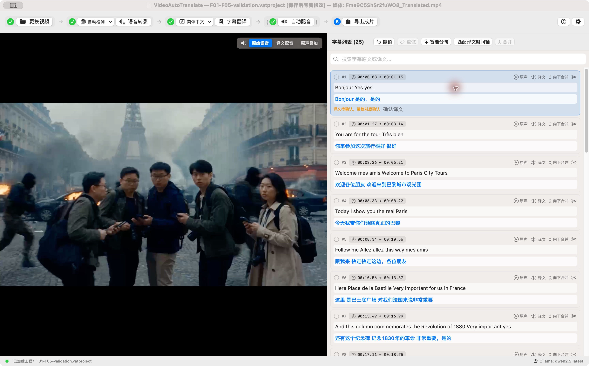
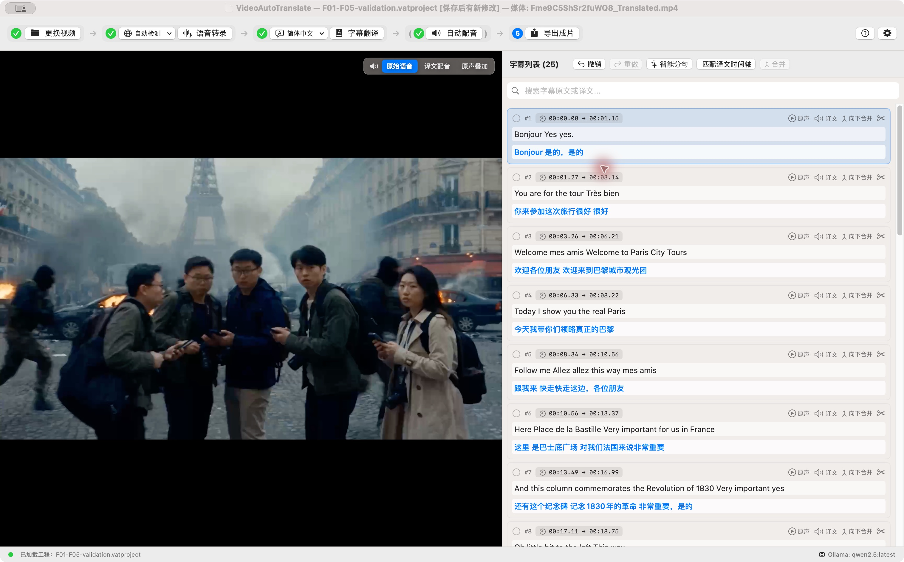

# 现有功能可用性评审

基线：PR #36 合并后的 `main`，提交 `b4653b8b340e8884e5883a0760dda71456ac322e`。日期：2026-10-22。本版根据产品目标重新筛选原评审结果，取代上一版“24 项问题都应修复”的结论。

目标是让现有功能在正常操作中完整、正确、好用。验收以单个正常视频、已安装且可用的模型、选定后保持稳定的语言与音色为前提，顺序执行导入、识别、校对、翻译、时间轴匹配、配音、预览、保存和导出。

当前保留 **4 项功能问题和 1 项使用说明问题**。不因理论上的并发风险、未来语言版本诊断或尚未量测的性能风险扩大修复范围。以下问题描述保留评审时的现象；F01–F05 已完成修复，结果与验收记录见文末。

## 已修复的问题（评审时的现象）

### F01 P1 人工校对到试听和导出的流程不闭环

普通操作：转录并翻译字幕后，修正识别错误和对应译文，必要时拆分或合并，再试听、导出。

这条正常编辑路径存在三处不一致：

- 修改原文会把译文标成待复核，随后手工修正译文却不能完成复核，界面也没有明确的完成方式。用户已经校对好的行仍可能不能配音或导出字幕。
- 拆分或合并会把待复核状态重置为已确认，原本尚未确认的旧译文反而被当成有效结果。
- 字幕文件导出会检查待复核状态；原声音轨加双语字幕的视频导出却跳过该检查。同一份校对结果在不同导出方式下行为不一致。

证据：待复核行手工改译文后状态仍为 true；拆分、合并后状态变为 false，均已通过隔离业务探针复现。视频任务没有统一复核检查也已验证。本项仅保留普通校对场景，不把构造越界字幕作为当前修复要求。

定位：[字幕编辑状态](../Sources/VideoAutoTranslateCore/Models/SubtitleItem.swift#L22)、[拆分和合并](../Sources/VideoAutoTranslateCore/Manager/SubtitleManager.swift#L127)、[视频导出](../Sources/VideoAutoTranslateApp/ExportJob.swift#L27)。原编号：R12、R11，以及 R04 中与正常人工校对有关的部分。

最小改进：让用户提交修正后的译文能够完成当前行的校对；拆分、合并正确继承是否已确认的状态；字幕、视频及配音使用一致的判断。无需因此引入新的复杂审核工作流。

验收：修正一处原文和译文后能够试听、配音、导出；对校对中的行拆分、合并不错误确认旧译文；保存后重开保留同样的校对结果。

### F02 P2 原声叠加导出的背景音质量与预览不一致

普通操作：完成一次转录和配音，选择“原声压低叠加”导出。

转录把 `project.audioURL` 指向识别用的 16kHz 单声道 WAV，叠加导出将它作为背景。预览使用源视频音轨，因此用户听到的预览和导出使用的背景素材不同。保存再打开后，背景引用又恢复为源视频，同一工程的导出行为不一致。

证据：当前样本源音轨为 48kHz 双声道，抽取器明确转换为 16kHz 单声道；导出直接使用该识别文件。这是已确认的数据流问题，本轮未追加主观音质评价。

定位：[识别音频赋值](../Sources/VideoAutoTranslateApp/AppState.swift#L422)、[导出背景参数](../Sources/VideoAutoTranslateApp/ExportView.swift#L292)、[叠加混音](../Sources/VideoAutoTranslateApp/ExportJob.swift#L41)。原编号：R14。

最小改进：识别 WAV 仅用于识别；叠加导出使用源视频的原始音轨，保持预览、首次导出和重开后的导出一致。

验收：使用现有测试视频核对首次导出和重开后的叠加导出，背景声道与可听频段不因识别用降采样而丢失，闪避和配音位置保持正确。

### F03 P2 保存重开后丢失配音倍速提示

普通操作：匹配译文时间轴并生成配音，保存工程，退出后再次打开。

`dubbedRate` 用于显示配音倍速和快语速提示，却没有持久化；自然语速缓存也不持久化。重开后音频依然是加速版本，界面上的倍速说明却可能消失。

证据：编码、解码字段均未包含 `dubbedRate`，倍速显示的两个数据来源在重开后都可能为空。属于静态确认，尚未作为单独界面场景复测。

定位：[倍速与告警](../Sources/VideoAutoTranslateCore/Models/SubtitleItem.swift#L43)、[持久化字段](../Sources/VideoAutoTranslateCore/Models/SubtitleItem.swift#L153)。原编号：R20。

最小改进：随已保存配音保留实际倍速，打开工程后恢复现有显示，不要求新增质量分析功能。

验收：一条已显示倍速的字幕保存重开后，音频可播放，倍速数值和已有快语速提示保持一致。

### F04 P2 转录过程中的取消按钮没有覆盖自动分句阶段

普通操作：开始转录，在自动智能分句阶段点击一次“取消”。

当前取消句柄只覆盖前面的抽取和 ASR；后续自动分句仍能继续发请求，并更新已经取消任务的进度。这里保留的是现有取消按钮本身的正确性，不要求连续取消重试、并行任务或服务端立刻释放 GPU。

证据：240 词分两批，在第一批分句请求期间取消后，服务仍收到第二批，界面状态数据被更新为分句完成、进度 0.99。已用隔离服务复现。

定位：[当前取消句柄](../Sources/VideoAutoTranslateApp/AppState.swift#L453)、[自动分句阶段](../Sources/VideoAutoTranslateApp/AppState.swift#L476)。原编号：R07。

最小改进：现有转录任务的取消覆盖完整流程；取消后不发起后续分句，不再更新该任务的进度。无需为本项重构全部后台服务。

验收：单次正常转录在自动分句阶段取消后，界面恢复可操作，后续批次不再发出，已有工程内容保持原样。

### F05 P3 首次使用说明与发布包不一致

普通操作：阅读首次使用说明，安装并启动发布包。

README 称应用不含 Python、必须先安装解释器，但打包脚本实际包含独立运行环境，设置也优先展示内置环境。另外，离线使用说明需要区分本地识别、翻译与默认联网 Edge 配音。

定位：[首次运行说明](../README.md#L50)、[打包内置环境](../build_app.sh#L30)。原编号：R24。

最小改进：按实际发布包写清第一次启动的步骤，外部 Python 作为源码运行或环境修复的说明，不把它写成所有用户的前置条件；说明两类配音引擎的联网要求。

验收：用户按文档能够判断自己需要安装什么、先点击哪里，以及哪些功能需要联网。

## 移出当前修复范围的原发现

以下条目不再作为当前功能交付的阻碍，不表示上一轮观察到的现象已被修复。

| 原编号 | 情形 | 本轮处理 |
| --- | --- | --- |
| R01 | 把源视频选成工程或字幕保存目标 | 误选目标的防护，不纳入正常保存流程要求 |
| R02 | 崩溃恢复入口与副本清理 | 异常恢复暂缓；正常工程保存和重开仍需验证 |
| R03、R05 | 处理中切换语言、视频或预览请求的竞态 | 移出；当前按固定视频和配置顺序使用 |
| R06 | 打开引用缺失媒体的工程 | 异常素材恢复暂缓 |
| R08、R09、R10 | 服务端并发推理、同时唤醒、取消后立刻重试下载 | 并发和重试时序加固暂缓 |
| R13、R22 | 两小时音频和大量字幕位图的内存规模 | 超长、超大场景暂缓，不据静态增长推断当前样本不可用 |
| R15 | 残缺模型缓存的就绪误判 | 损坏或残缺缓存恢复暂缓 |
| R16 | emoji、组合字符等光标偏移 | 特殊字符边界暂缓 |
| R17 | 未接入界面的人工调时接口 | 不新增调时面板、波形等功能；现有时间标签按定位功能验收 |
| R18 | CLI 回退进程取消和超时 | 回退链路加固暂缓 |
| R19 | 试听还在生成时关闭设置的异步收尾 | 中途关闭的时序边界暂缓；正常试听、播放和停止仍需正确 |
| R21 | 不可信网页向本地服务发请求 | 安全加固不纳入本轮功能可用性清单 |
| R23 | Python 诊断脚本将部分成功当成全量成功 | 作为验收方法限制记录，不计入应用功能缺陷；不能据其成功文字判定成片合格 |
| 并发诊断 | Swift 6 严格并发迁移 | 当前构建能通过，不把未来语言模式迁移列为本轮交付要求 |

R04 中人为构造越界字幕、漏句计数等异常输入检查同样移出；仅保留 F01 中普通人工校对后的导出一致性。

## 本轮验收标准

围绕同一个正常样本按顺序验收，不穿插更换媒体、改任务配置或制造服务故障：

1. 导入现有测试视频，播放和定位正确。
2. 转录、自动智能分句、翻译完成，字幕内容和数量可核对。
3. 修改几行正常原文和译文，拆分、合并、撤销、重做后结果符合操作意图。
4. 匹配时间轴、试听、自动配音，字幕与配音对应；单独验证一次取消按钮。
5. 在原声、译文配音、原声叠加三种预览中检查实际播放内容。
6. 保存工程并重新打开，字幕、译文、配音和现有倍速显示保留。
7. 导出字幕与代表性视频模式，核对内容、音轨、字幕显示和时长；叠加导出的背景音与预览一致。
8. 帮助和设置按正常方式打开、选择、试听、完成，说明与真实行为一致。

范围重排时的基线为常规测试 101 项、0 失败、1 项默认跳过，构建与脚本检查通过。修复后的验证记录见下文。后续以这些正常操作的实际输出为验收依据，测试数量、编译警告数量或单纯“导出成功”提示不替代功能结果检查。

## 保留的验证材料

- 评审时的隔离业务探针复现了人工译文复核、拆分合并状态、分句取消和导出复核问题；修复后已用提交到仓库的回归测试覆盖。
- [原生界面与真实视频验收记录](2026-10-22-ui-acceptance.md)：已有正常主流程、帮助、设置及导出检查。
- 修复后的回归测试位于 `Tests/VideoAutoTranslateCoreTests/`。

修复顺序为 F01、F02、F03、F04，F05 随使用说明一起更新。完成标准是上述现有功能顺序使用可用、结果正确，不要求把暂缓项目同时实现。

## F01–F05 修复与验收记录

日期：2026-10-22。修复限于上述正常使用流程。

| 编号 | 修复结果 | 验证 |
| --- | --- | --- |
| F01 | 手工改译文自动完成确认；原译文无需改动时可点击“确认译文”；拆分、合并保留待确认状态；视频导出与字幕导出统一检查实际使用的译文 | 人工修正后合成试听音频、导出字幕、保存重开；结构编辑状态和视频导出拦截回归测试；发布构建界面操作复核 |
| F02 | 叠加导出始终使用源视频原始音轨，不使用识别用的 16kHz 单声道文件 | 原生媒体集成测试先生成双声道 48kHz 视频并抽取识别 WAV，再叠加导出，解码并量测 10kHz 高频及左右声道差异，均保留 |
| F03 | 工程保存实际配音倍速，重开恢复倍速及快语速提示，兼容旧工程 | 保存后删除临时源配音，再重开工程，验证工程内音频可播放、签名和 1.7 倍速提示不变；旧工程解码测试 |
| F04 | 转录取消句柄覆盖自动分句阶段；取消后不发下一批请求、不写回旧进度与字幕 | 本机 HTTP 测试服务接收 240 词分批请求，在首批响应前取消，再释放响应；仅收到 1 批、字幕保持原样、任务恢复空闲且状态为已取消 |
| F05 | 首次使用说明与内置运行环境一致，区分模型下载、源码运行和两类配音的联网要求 | 对照打包脚本与设置入口核查 README；未宣称完成全新机器安装测试 |

验证结果：

- 完整 Swift 测试：111 项，0 失败，其中 1 项真实视频测试默认跳过。
- 单独启用真实视频测试：1 项通过，25/25 句真实中文配音可试听，完整配音及视频导出通过，成片时长约 78.37 秒。
- 对该成片完整解码，未报告音视频解码错误。
- Release 构建通过；发布元数据、发布说明和 ASR 结果脚本检查通过。
- 使用独立测试工程验证发布构建界面：修改原文出现待确认提示，点击确认后提示消失；再次修改原文及译文后自动完成确认并成功保存。提示、按钮和相邻字幕布局清晰，无遮挡或截断。

界面证据：

图中使用测试视频和独立验收工程，不覆盖原工程。F03 的倍速播放与持久化由实际音频回归测试验证；此处截图仅展示 F01 的确认操作。本次未重新遍历所有帮助、设置及每个界面，历史界面覆盖范围见前述验收记录。
